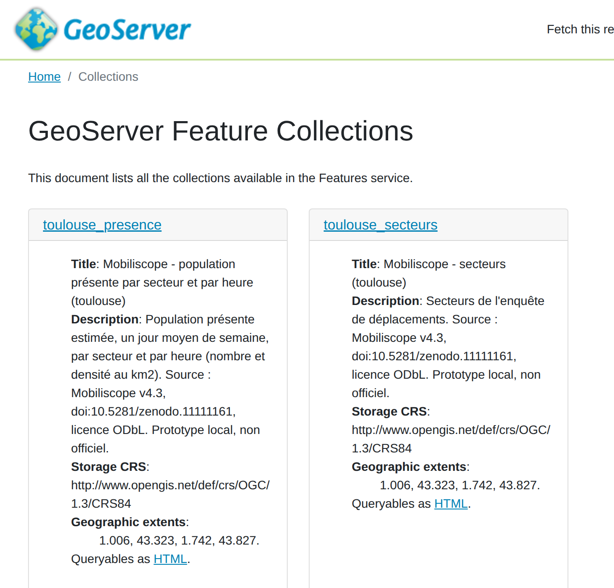
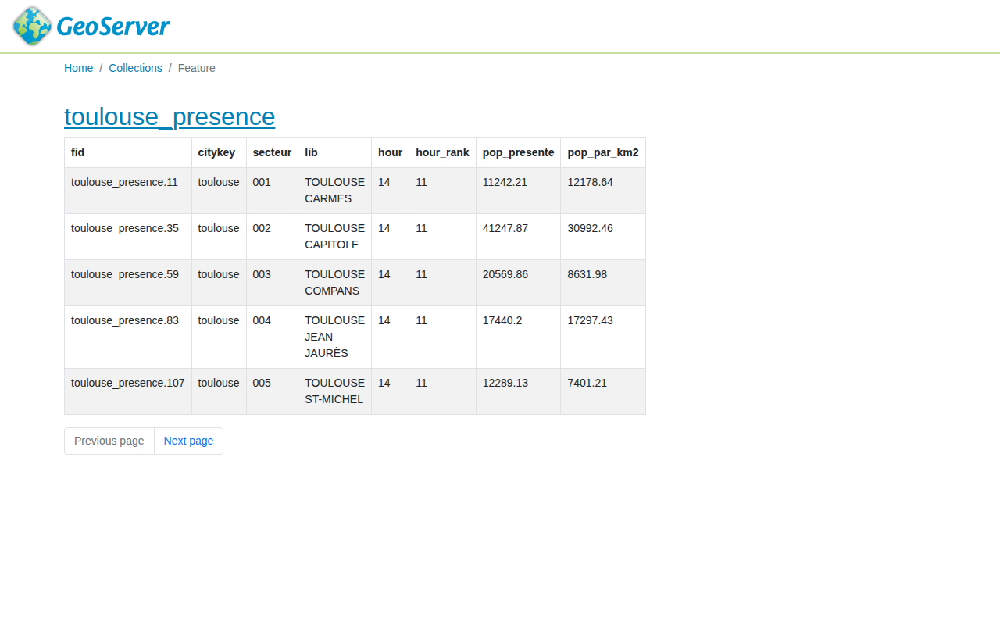

# An OGC API over the Mobiliscope open data: local prototype

An exercise, not a service: one city of the [Mobiliscope](https://mobiliscope.cnrs.fr) open data (v4.3, ODbL, doi:10.5281/zenodo.11111161) served locally as standard geospatial web services by GeoServer. Not affiliated with the Mobiliscope project. Nothing here is online.

## Why

The Mobiliscope publishes its data as files: one folder per city on Zenodo, read by the website from an S3 bucket. To get "the population present in each sector of Toulouse at 2 pm", a reuser downloads 4.6 GB and reads the right column of the right file. A standard API answers the same question with one URL, from QGIS, R, Python or a browser, and can be listed in a catalogue.

The question tested here: how much work is it to put such an API in front of the existing open data, without changing them?

## What it does

| Step | Tool | File |
|---|---|---|
| Reshape one city from one column per hour to one row per sector and hour | Python, standard library | `prepare_data.py` |
| Pack the layers into a GeoPackage | GDAL (`ogr2ogr`) | `make api-data` |
| Serve them | GeoServer 2.28.5, official OSGeo image, OGC API - Features module | `docker-compose.yml`, profile `api` |
| Declare workspace, datastore and layers | GeoServer REST API, with `curl` | `publish.sh` |
| Compare the answers with the source files | Python, standard library | `check_api.py` |

The layers are declared through the REST API, never through the web interface. This is the mechanism that R tools such as `geosapi` and `geoflow` drive on larger infrastructures, for example Geodata INRAE.

Two collections:

- `toulouse_secteurs`: the 66 survey sectors.
- `toulouse_presence`: 1,584 features, one per sector and hour, with `hour` (0-23), `hour_rank` (1-24, the Mobiliscope day starts at 4 am), `pop_presente` (number of people present) and `pop_par_km2`.

## Run it

Needs the main setup of this repository (see `../README_setup.md`) with the open data unzipped, plus `python3` and GDAL on the host.

```bash
make api-data      # builds ogcapi/data/toulouse.gpkg (22 MB)
make api-up        # starts GeoServer; the first start downloads the OGC API module
make api-publish   # four REST calls, each should answer 201
make api-check     # five URLs answer 200, four comparisons print OK
make api-down
```

Another city: `make api-data api-publish api-check CITY=rennes`.

Then, in a browser:

- http://127.0.0.1:8600/geoserver/mobiliscope/ogc/features/v1 (landing page, OpenAPI description)
- http://127.0.0.1:8600/geoserver/mobiliscope/ogc/features/v1/collections
- http://127.0.0.1:8600/geoserver/mobiliscope/ogc/features/v1/collections/toulouse_presence/items?filter=hour=14

The filter is CQL2 text, so `filter=secteur='001' AND hour=14` or `filter=pop_par_km2>10000 AND hour=3` also work.

In QGIS: Layer > Add Layer > Add WFS / OGC API - Features Layer, new connection with the landing page URL above.

The same GeoServer also answers WMS and WFS at `http://127.0.0.1:8600/geoserver/mobiliscope/wms` and `/wfs`.

## Result (10 October 2026)

| Check | Result |
|---|---|
| Landing page, conformance, collections, two `items` requests | 200 |
| Sectors returned by the API | 66, as in the source layer |
| Features at 14:00, filtered on the server | 66 |
| Largest difference with `stacked/pop_prop_stacked.csv` at 14:00 | 0 |
| Total population present at 14:00 | 805,650 on both sides |
| Declared conformance | OGC API - Features parts 1 (core, GeoJSON, HTML, OpenAPI 3.0), 2 (CRS) and 3 (filtering, CQL2) |

The collections page, as GeoServer serves it:



The population present at 14:00, filtered on the server:



## Limits

- **One city, one indicator** (total population). The other indicators follow the same file pattern but were not loaded.
- **No flows.** Flow data are not in the open data, for confidentiality reasons, and must stay out of any public API.
- **No styling.** WMS draws grey polygons; no SLD was written.
- **No catalogue record.** A real service would come with ISO 19115 or DCAT metadata, so that national catalogues can harvest it.
- **No statistical caution in the answers.** The website warns about sampling error in small sectors; an API should carry that warning in its metadata.
- **Not hardened.** Default administrator account, no HTTPS, configuration lost when the container is removed. Fine on 127.0.0.1, nowhere else.
- **Geometry repeated 24 times** in the long-form layer (49 MB of GeoJSON for one city). A database view joining sectors and values would avoid it.
- **Not loaded in QGIS** during this run; the QGIS step above is the standard procedure, not a tested one.
- **A second service to maintain.** GeoServer is a Java application with its own release and security cycle. A lighter server (pygeoapi) or static cloud-native files (GeoParquet, PMTiles) would be worth comparing before choosing.

Prepared with AI assistance (Claude).
